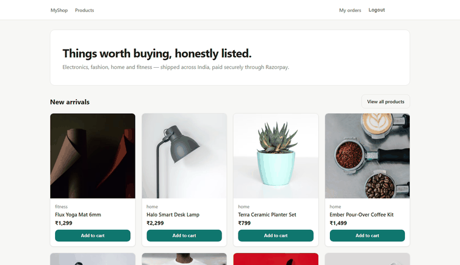

# MyShop — Full-Stack E-commerce

<p>
  
</p>

A complete e-commerce MVP built end to end: **Next.js (React, JavaScript)** storefront, **FastAPI** backend, **PostgreSQL** database, **Razorpay** payments — from first route to verified payment, in one repo.

## Verification in action

Register → the 6-digit code appears **on screen** (dev mode; email it via SMTP config) → typed in → account verified → logged into the live store. One continuous take, no cuts:

<p>
  
</p>

## Features

**Storefront (Next.js App Router)**
- Product listing with live search (debounced), category filter and price sort
- Product detail pages with stock awareness
- Authenticated cart: add, adjust quantity, remove — with server-side validation
- Checkout collects shipping details and opens the **Razorpay payment modal**
- Order history and order detail with status tracking
- Admin panel: create/edit/hide products, view all orders, advance order status

**Backend (FastAPI + SQLAlchemy 2.0 + PostgreSQL)**
- JWT auth with bcrypt + **6-digit code verification** before first login (code shows on-screen in dev — no mail server needed)
- REST router per domain: `auth`, `products`, `cart`, `orders`, `admin`
- **Razorpay order creation + server-side signature verification** — a browser can't fake "payment successful"
- Orders keep **snapshots** of product names/prices, so history survives product edits
- Soft-delete products (`is_active`) so old orders stay intact
- Interactive docs at `/docs` (OpenAPI)

## Tech stack

| Layer | Choice |
|---|---|
| Frontend | Next.js 14, React 18, plain CSS (no UI kit) |
| Auth | JWT bearer tokens, passlib/bcrypt |
| Backend | FastAPI, SQLAlchemy 2.0, Pydantic v2 |
| Database | PostgreSQL |
| Payments | Razorpay Orders API + HMAC-SHA256 verification |
| Storage | Money as **integer paise** everywhere — floats never touch money |

## Project structure

```
ecommerce/
├── backend/
│   ├── app/
│   │   ├── main.py            # FastAPI app + CORS
│   │   ├── config.py          # env settings
│   │   ├── database.py        # engine, session, Base
│   │   ├── models.py          # ORM models
│   │   ├── schemas.py         # request/response bodies
│   │   ├── security.py        # hashing + JWT
│   │   ├── deps.py            # current user / admin guards
│   │   ├── seed.py            # tables + admin + demo catalog
│   │   ├── routers/           # auth, products, cart, orders, admin
│   │   └── utils/razorpay.py  # order creation + signature check
│   ├── requirements.txt
│   └── .env.example           # never commit your real .env
└── frontend/
    ├── app/                   # Next.js App Router pages
    ├── components/            # Navbar, ProductCard
    ├── lib/api.js             # single fetch wrapper
    └── package.json
```

## Run it locally

Full setup guide in [SETUP.md](SETUP.md) — the short version:

```bash
# 1. PostgreSQL: create a database named "shop", then
cd backend
python -m venv .venv
.venv\Scripts\activate        # Windows | macOS/Linux: source .venv/bin/activate
pip install -r requirements.txt
copy .env.example .env        # then set DATABASE_URL + JWT_SECRET
python -m app.seed            # tables + admin user + demo catalog
uvicorn app.main:app --reload  # → http://localhost:8000/docs

# 2. new terminal
cd ../frontend
npm install
copy .env.local.example .env.local
npm run dev                    # → http://localhost:3000
```

**Admin login after seeding:** email from `ADMIN_EMAILS` (default `admin@shop.com`), password `admin123` — change the password immediately in any non-local use.

## Payments — how they actually work

1. `POST /orders` snapshots the cart into `order_items`, creates a matching **Razorpay order** via the SDK, returns the order id + amount + public key id
2. Frontend opens the Razorpay checkout modal
3. Razorpay returns `order_id | payment_id | signature`
4. `POST /orders/verify` recomputes `HMAC-SHA256(order_id|payment_id, key_secret)` server-side and compares before marking the order `paid`, decrementing stock and clearing the cart

Verification is idempotent. Without Razorpay keys configured, checkout fails with `503 "Payment gateway is not configured"` — everything else works.

## Verification — a 6-digit code, no mail server required

1. `POST /auth/register` creates the account (bcrypt-hashed password) and generates a **6-digit code**.
2. Where does the code go?
   - **No SMTP configured (the default)** → *dev mode*: the code is returned to the verify screen and displayed under the form. Nothing to install, no accounts, no waiting.
   - **SMTP configured in `.env`** (Gmail app password — see SETUP.md) → the code is **emailed**, and the response carries no code.
3. The DB stores only the **SHA-256 hash**, plus a **10-minute expiry** — leak the database and the codes are still useless. Six wrong attempts kills the code and forces a fresh one (`MAX_CODE_ATTEMPTS`).
4. `POST /auth/verify-code {email, code}` → verified. Unverified logins get a clear `403`; the login page then deep-links to the `/verify` screen (same field, resends included).
5. `POST /auth/resend {email}` never reveals whether an account exists (always `200`), and it's **cooldown-limited per user** (120 s).

No browser redirects, no mail-encoding edge cases, no third service between you and your own database.

A self-contained smoke test is included:

```bash
cd backend
.venv\Scripts\python.exe e2e_verify.py # full flow: registers, wrong-codes, verifies, logs in, checks the lockout
```

## Notes on choices

- **JWT in localStorage** — the simplest correct thing for a demo; production would move to httpOnly cookies + CSRF handling
- **No Alembic yet** — `seed.py` creates tables directly; add migrations when the schema starts evolving under real data
- **Product images are URLs** — no upload pipeline in v1

## License

[MIT](LICENSE)
